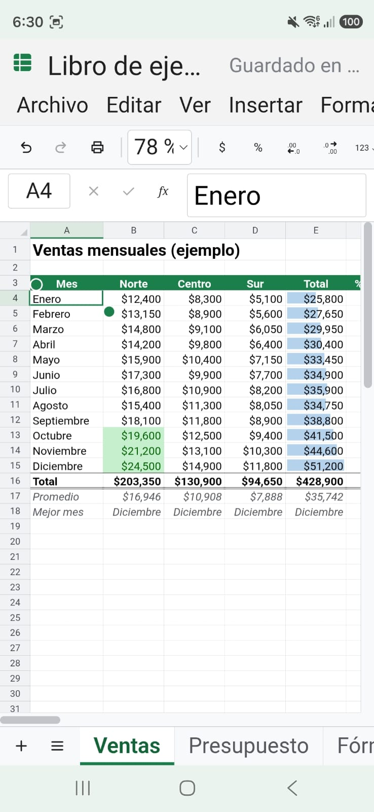
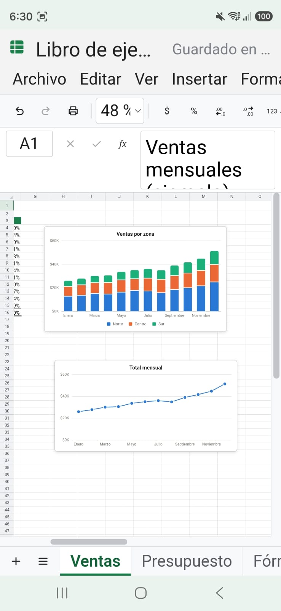
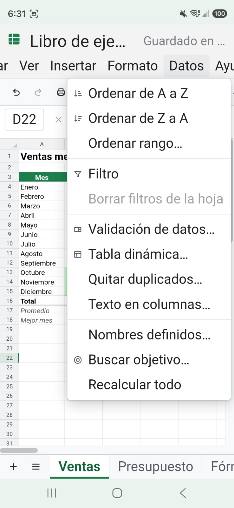
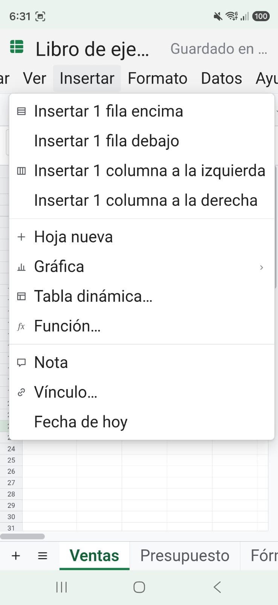
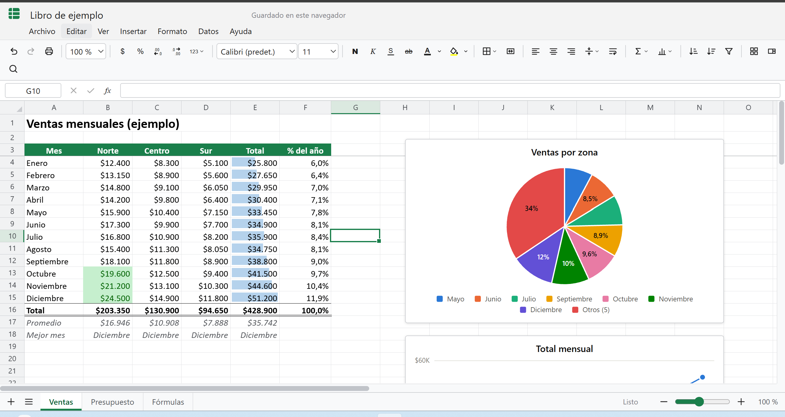
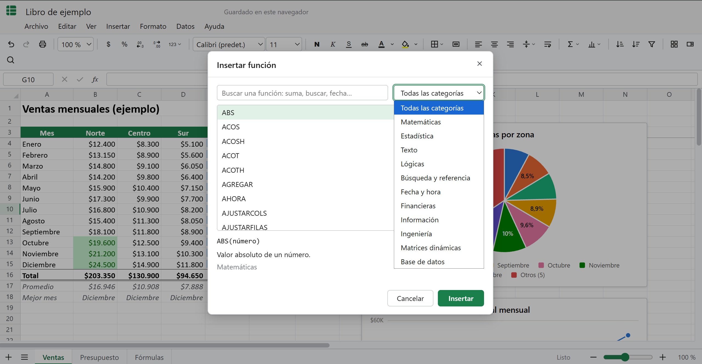

# Hoja de cálculo

Hoja de cálculo en español para el navegador y Android. Ambas versiones funcionan sin conexión.

## Android

Descarga la [APK 1.3.1](https://raw.githubusercontent.com/jceronch1/Hoja-de-Calculo/main/dist/Hoja-de-calculo.apk), ábrela desde **Archivos** en el teléfono e instálala.
Si Android solicita autorización para esa fuente, actívala para la aplicación desde la que estás
abriendo el archivo. La APK está firmada para instalación directa y admite Android 8.0 o posterior.
Mantén actualizado Android System WebView para abrir libros de Excel comprimidos.

- Toca una celda para seleccionarla, tócala dos veces para editar dentro de ella
  o mantenla pulsada para abrir el menú contextual. También puedes editar desde la barra de fórmulas.
- Para autorrellenar, mantén pulsada la selección y elige **Autorrellenar con el dedo › Continuar serie**
  o **Copiar celdas**. Arrastra el tirador cuadrado hasta el destino y suelta.
- La edición dentro de la celda conserva el tamaño del texto al hacer zoom. El borde punteado
  desaparece tras el primer pegado y puedes seguir pegando el mismo contenido.
- Arrastra la cuadrícula para desplazarte. Toca una celda y arrastra uno de los tiradores de selección
  con un dedo para marcar un rango. Junta o separa dos dedos sobre la hoja para cambiar el zoom.
  **Ver › Zoom › 25 %** ofrece una vista general. Desliza la barra de herramientas para ver más comandos.
- Arrastra la línea entre dos letras para ajustar la columna de la izquierda, o la línea entre dos
  números para ajustar la fila de arriba. Consulta **Ayuda › Gestos y acciones** para ver los controles táctiles.
- Usa **Archivo › Abrir** para importar un libro y **Archivo › Guardar como › Excel (.xlsx)** para
  elegir dónde guardarlo. El libro abierto se guarda automáticamente dentro de la app.
- En **Archivo › Guardar como › PDF (.pdf)**, elige la hoja actual con sus gráficas o el rango
  seleccionado y la orientación inicial. En la vista de Android, elige **Guardar como PDF**.

Para reconstruir la APK en Windows, usa JDK 17 o posterior, Android SDK Platform 36 y Build Tools 36.1.0.
Con ANDROID_HOME y JAVA_HOME configurados, ejecuta `.\android\build.ps1` en PowerShell.
El script coloca la APK en `dist/` y conserva la clave de firma en `android/.signing/`.
Guarda esa carpeta en privado para poder firmar futuras actualizaciones.

## Pantallazos de Android

| Hoja de ventas | Gráficas | Menú Datos | Menú Insertar |
| --- | --- | --- | --- |
|  |  |  |  |

## Pantallazos de la versión web






## Cómo abrirla

Doble clic en `index.html` (Chrome, Edge o Firefox recientes). El libro se guarda solo en el navegador;
para conservarlo o compartirlo usa **Archivo › Descargar como Excel (.xlsx)**. **Archivo › Abrir libro de ejemplo**
carga un libro con datos, fórmulas y gráficas para probarla.

En web y Android, selecciona el rango con encabezados y activa **Datos › Filtro**. Abre la flecha
del encabezado para buscar o marcar valores, aplicar condiciones, ordenar o quitar el filtro de esa columna.

## Qué incluye

- **Fórmulas**: 385 funciones con nombre en español o inglés (SUMA/SUM, SI, BUSCARV, BUSCARX, SUMAR.SI.CONJUNTO,
  FILTRAR, ORDENAR, UNICOS, LET, LAMBDA, financieras, estadísticas, fechas, texto, ingeniería…), matrices dinámicas
  que se desbordan (`A1#`), referencias entre hojas, nombres definidos, autocompletado y ayuda de argumentos, F4 para `$`.
- **Edición**: copiar, cortar y pegado especial; relleno de series (números, fechas, días, meses); deshacer y rehacer;
  insertar y eliminar filas y columnas; ocultar; buscar y reemplazar; notas y vínculos.
- **Formato**: números, moneda, porcentaje, fechas y formatos personalizados; fuente, colores, bordes, alineación,
  ajuste de texto, combinar celdas, formato condicional (reglas, escalas de color, barras de datos), paneles inmovilizados.
- **Datos**: ordenar, filtro automático, validación de datos (listas desplegables), quitar duplicados, texto en columnas,
  tabla dinámica, buscar objetivo.
- **Gráficas**: columnas, barras, líneas, áreas (apiladas y al 100 %), circular, anillo, dispersión, burbujas, radial,
  combinada e histograma; se mueven y redimensionan, muestran valores al pasar el ratón y se exportan a PNG o SVG.
- **Archivos**: abre y guarda `.xlsx` (con fórmulas, estilos, gráficas, notas, validación y formato condicional),
  `.csv` y una copia completa `.json`; imprime la hoja con sus gráficas.

## Límites conocidos

- No abre el formato antiguo `.xls` ni ejecuta macros.
- Al abrir un `.xlsx`, las fórmulas con funciones que no existen aquí (por ejemplo, de cubos OLAP) conservan su último valor.
- La tabla dinámica es un resumen con fórmulas: se actualiza al cambiar los datos, pero los elementos nuevos requieren crearla otra vez.
- Sin conexión a internet no se cargan las fuentes que no estén instaladas en el equipo (se usa la fuente del sistema).

## Pruebas

```bash
node tests/run.js
```
