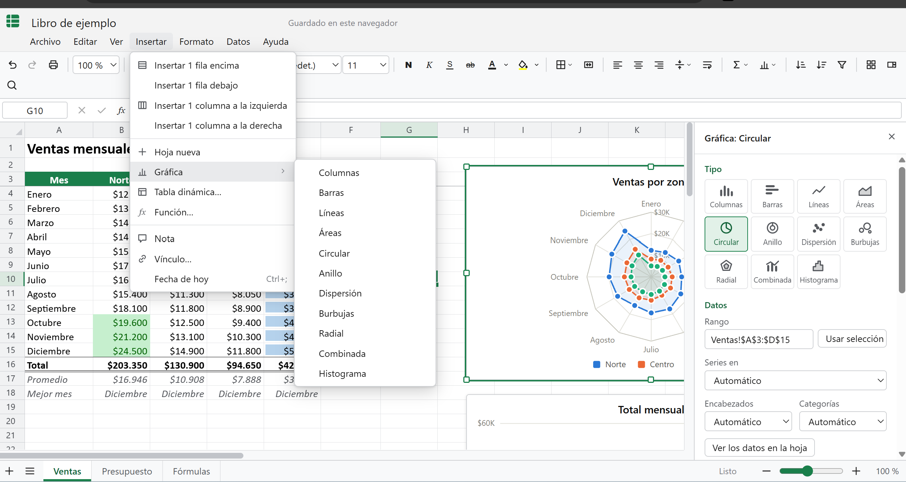

# Hoja de cálculo

Aplicación web de hoja de cálculo que funciona sin instalar nada y sin conexión.

## Pantallazos




## Cómo abrirla

Doble clic en `index.html` (Chrome, Edge o Firefox recientes). El libro se guarda solo en el navegador;
para conservarlo o compartirlo usa **Archivo › Descargar como Excel (.xlsx)**. **Archivo › Abrir libro de ejemplo**
carga un libro con datos, fórmulas y gráficas para probarla.

## Qué incluye

- **Fórmulas**: 385 funciones con nombre en español o inglés (SUMA/SUM, SI, BUSCARV, BUSCARX, SUMAR.SI.CONJUNTO,
  FILTRAR, ORDENAR, UNICOS, LET, LAMBDA, financieras, estadísticas, fechas, texto, ingeniería…), matrices dinámicas
  que se desbordan (`A1#`), referencias entre hojas, nombres definidos, autocompletado y ayuda de argumentos, F4 para `$`.
- **Edición**: copiar, cortar y pegado especial; relleno de series (números, fechas, días, meses); deshacer y rehacer;
  insertar y eliminar filas y columnas; ocultar; buscar y reemplazar; notas y vínculos.
- **Formato**: números, moneda, porcentaje, fechas y formatos personalizados; fuente, colores, bordes, alineación,
  ajuste de texto, combinar celdas, formato condicional (reglas, escalas de color, barras de datos), paneles inmovilizados.
- **Datos**: ordenar, filtro automático, validación de datos (listas desplegables), quitar duplicados, texto en columnas,
  tabla dinámica, buscar objetivo.
- **Gráficas**: columnas, barras, líneas, áreas (apiladas y al 100 %), circular, anillo, dispersión, burbujas, radial,
  combinada e histograma; se mueven y redimensionan, muestran valores al pasar el ratón y se exportan a PNG o SVG.
- **Archivos**: abre y guarda `.xlsx` (con fórmulas, estilos, gráficas, notas, validación y formato condicional),
  `.csv` y una copia completa `.json`; imprime la hoja con sus gráficas.

## Límites conocidos

- No abre el formato antiguo `.xls` ni ejecuta macros.
- Al abrir un `.xlsx`, las fórmulas con funciones que no existen aquí (por ejemplo, de cubos OLAP) conservan su último valor.
- La tabla dinámica es un resumen con fórmulas: se actualiza al cambiar los datos, pero los elementos nuevos requieren crearla otra vez.
- Sin conexión a internet no se cargan las fuentes que no estén instaladas en el equipo (se usa la fuente del sistema).

## Pruebas

```bash
node tests/run.js
```
